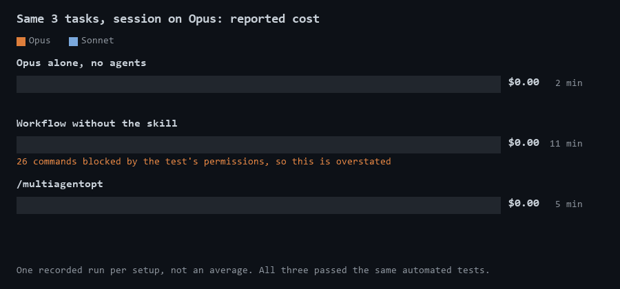

# multiagentopt

A [Claude Code](https://claude.com/claude-code) skill for running a batch of tasks with parallel agents, without paying top-model prices for simple work.



## The problem

In multi-agent runs, such as Claude Code's ultracode mode (which hands work to a workflow of many agents), each agent uses the session's model unless told otherwise. In an Opus session, that means Opus starting another Opus just to read a few files or make a small change.

## What it does

The agent running the session chooses a model for every task and every subagent, based on how hard the work is:

| Work | Who does it |
|---|---|
| Understanding why something happens, debugging, design decisions | **Opus** |
| Implementing something already specified, verification, review | **Sonnet** |
| Reading files, broad searches with a closed and checkable answer, simple mechanical tasks | **Haiku** |
| The same mechanical change across many files | **No model**: a script, written once and then simply run |

So Opus calls Sonnet or Haiku for simple work. Opus only starts another Opus for a part that needs design or debugging judgment of its own.

Saving tokens is no use if parallel agents break each other's work, so the skill also handles that:

- **Shared decisions come first.** The main session fixes anything tasks must agree on, such as ids, function signatures and data structures, and copies it into every brief. Left alone, parallel agents invent different values.
- **Agents share one working tree safely.** They edit existing files through `patch.py`, which locks each file and preserves its bytes and line endings.
- **Work gets checked.** When the batch runs as a workflow (in ultracode mode, or because you asked for one), a Sonnet agent tries to find defects in each task, and a fix runs only if it confirms some.
- **Builds run once.** Agents don't run the shared build. The main session runs it at the end, because two builds on the same tree collide.

## Example

```text
/multiagentopt
1. Add pagination to the /orders endpoint
2. Find out why the checkout total is sometimes one cent off, and fix it
3. Add the new error message to all 12 locale files
```

In the recorded test run, the session split that batch like this:

| Task | Work | Ran on |
|---|---|---|
| All | Read the code and plan the batch | Opus, in the main session |
| 1 | Implement the pagination | Sonnet |
| 2 | Find the root cause and fix it | Sonnet |
| 3 | Add the line to the 12 files | A script Opus wrote once |
| All | Try to find defects | Sonnet |

The model doesn't always follow the routing table exactly. Here it gave the bug to Sonnet, although the table gives debugging to Opus, and it used no Haiku because the main session had already read the code.

## Results

These are single recorded runs of that batch on a small sample project, in a session on Opus. All three setups passed the same automated tests.

| Setup | Models used | Output tokens | Reported cost | Time |
|---|---|---:|---:|---:|
| Opus alone, no agents | Opus | 15,096 | $0.64 | 2 min |
| Workflow without the skill | Opus only | 97,890 | $3.75 | 11 min |
| `/multiagentopt` | Opus and Sonnet | 42,756 | $1.63 | 5 min |

What this shows, and what it doesn't:

- **Routing works as described.** The plain workflow set no model, so every agent ran on Opus. With the skill, the agents ran on Sonnet.
- **The saving is not measured precisely.** In the plain workflow run, the test's permissions blocked 26 commands and its agents had to retry, so its cost is overstated. The skill run had no blocked commands, and the Opus-alone run had 2. Cost also depends on cache timing, and these are single runs.
- **For a small batch, skip the agents.** Opus alone was the cheapest by far. In the skill run, the main Opus session alone cost $0.88, more than doing all the work without agents.

Use this skill when a batch is too large for one session, or when you were going to run a workflow anyway. Don't use it to make three small tasks cheaper.

## What's in this folder

| File | Purpose |
|---|---|
| `SKILL.md` | The instructions Claude follows: routing, contract, briefs, integration |
| `patch.py` | Byte-safe, locked file edits for agents working in parallel |

## patch.py

It needs Python 3.7+ and git, and has no other dependencies.

```python
import sys
sys.path.insert(0, r"<path to>/.claude/skills/multiagentopt")
from patch import replace, insert_after, insert_before, append, new_file

replace("src/app.py", "old text", "new text", enc="utf-8")
insert_after("src/app.py", "unique anchor\n", "added line\n", enc="utf-8")
```

After the agents finish, compare the changed files with `HEAD`, from inside the repository:

```bash
python ~/.claude/skills/multiagentopt/patch.py --verify
```

This reports any new U+FFFD replacement characters (a sign of a broken encoding) and any mixed line endings. Outside a git repository, it reports an error instead of checking nothing.

With no arguments, it only checks the files that `git diff` lists. Pass the paths explicitly to cover new untracked files, or a file whose only change is its line endings when `core.autocrlf` is on:

```bash
python ~/.claude/skills/multiagentopt/patch.py --verify src/new_file.py
```

Two defaults are worth knowing:

- **`enc` defaults to `latin-1`.** Pass the encoding of the file you are changing. On a UTF-8 file, non-ASCII text written with the default produces invalid UTF-8.
- **`new_file` defaults to CRLF.** Pass `crlf=False` if your project uses LF.

## Install

Clone it into your personal skills, so it works in every project:

```bash
git clone https://github.com/Nduli96/multiagentopt ~/.claude/skills/multiagentopt
```

Then type `/multiagentopt` followed by your task list.

## License

MIT. See [LICENSE](LICENSE).
